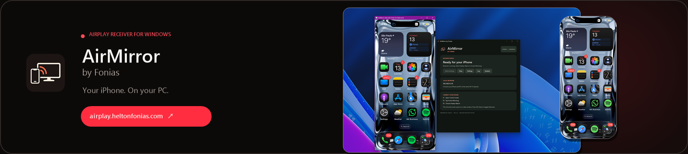
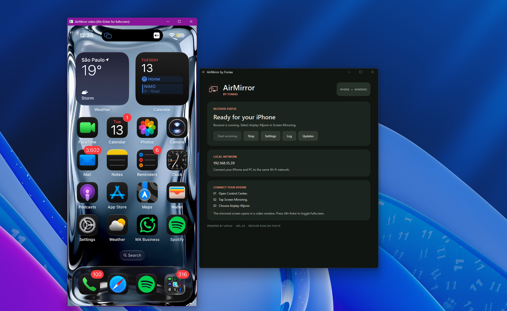
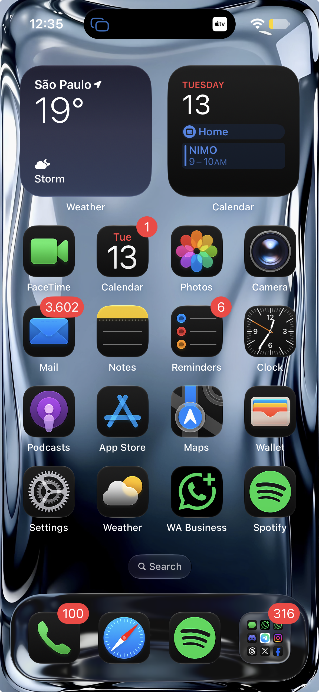

# AirMirror by Fonias

<p align="center">
  <a href="https://airplay.heltonfonias.com/" title="Visit the AirMirror website">
    
  </a>
</p>

<p align="center">
  <a href="https://airplay.heltonfonias.com/">Website</a> ·
  <a href="https://github.com/heltonfonias/AirMirror-by-Fonias/releases/latest">Download AirMirror</a> ·
  <a href="https://github.com/heltonfonias/AirMirror-by-Fonias/issues">Support the project</a>
</p>

**Mirror an iPhone to a Windows PC with one receiver app and one tray icon.** AirMirror is a Windows desktop interface built around the open-source [UxPlay](https://github.com/FDH2/UxPlay) AirPlay receiver. The receiver library runs inside `AirMirror.exe`; users do not need a separate UxPlay installation or a second UxPlay tray app. When mirroring starts, the video appears in its own renderer window inside the same process.

## Screenshots

These are the supplied AirMirror captures. Click either image to visit the website. The linked banner above is generated from the logo and these captures by `scripts/Create-ReadmeBanner.ps1`.

<p align="center">
  <a href="https://airplay.heltonfonias.com/"></a>
  &nbsp;&nbsp;
  <a href="https://airplay.heltonfonias.com/"></a>
</p>

## Download and install

Download the latest **`AirMirror-by-Fonias-x64.msi`** from [GitHub Releases](https://github.com/heltonfonias/AirMirror-by-Fonias/releases/latest). The MSI installs the app for the PC, adds a Start menu shortcut, and offers a desktop shortcut. Windows asks for administrator approval. The media DLLs, Qt libraries, GStreamer plugins, Bonjour helper, icon, and license file are packaged with the app. A separate UxPlay installation is unnecessary.

The **`AirMirror-by-Fonias-x64-portable.zip`** asset can be extracted and run without installing AirMirror. Keep every file and subfolder together. The in-app updater downloads the MSI; using it from a portable copy creates a regular installed copy, so portable users who want to remain portable should replace their extracted folder from the newer ZIP.

Windows may prompt for firewall access so the iPhone can reach the receiver. AirMirror uses Bonjour/mDNS for local discovery and can offer to install the Bonjour service when it is missing. That service is a Windows background service, not a second AirMirror tray app. AirMirror does not use UxPlay's optional Bluetooth beacon helper.

## Connect an iPhone

1. Put the iPhone and PC on the same local network, and open AirMirror.
2. On the iPhone, open **Control Center → Screen Mirroring**.
3. Select the receiver name shown in AirMirror. The default is `AirMirror-by-Fonias`; an existing UxPlay configuration may supply a different name.
4. The mirrored picture opens in a video window. With a Direct3D renderer selected, press **Alt+Enter** in that window to toggle fullscreen.

AirMirror preserves the aspect ratio of the video sent by the iPhone. The iPhone can choose a stream resolution below the maximum set in AirMirror. Photos, protected video, audio routing, latency, and device discovery are also affected by iOS, the network, renderer, and upstream UxPlay behavior. The app has been tested with an iPhone mirror connection; exact Photos gallery sizing has not been verified.

## App controls and settings

The main window shows receiver status, the name to select on iPhone, and the PC's local IPv4 address. **Start receiving** and **Stop** control the built-in receiver. **Settings** edits the receiver configuration; **Log** opens the current session log. Closing the window leaves AirMirror running in the tray. Right-click the tray icon for the same controls, an argument reference, license, update check, and **Quit AirMirror**.

Settings cover:

| Area | Controls |
| --- | --- |
| Display | Auto, Direct3D 11, Direct3D 12, or audio-only renderer; start mirrored video fullscreen |
| AirPlay identity | Receiver name and whether to append the PC hostname |
| Picture and sound | Maximum resolution, frame rate, H.265/HEVC, audio sink or mute |
| Connection | Allow a new device to take over; start AirMirror when signing in |
| Advanced | Additional UxPlay command-line arguments |

Saving settings restarts the receiver inside the same app process. It may interrupt an active mirror session. AirMirror reads `%APPDATA%\Fonias\AirMirror\arguments.txt` by default. If `%ProgramData%\uxplay-windows\arguments.txt` exists, that machine-wide file takes priority and must be edited by an administrator. On first run, AirMirror copies existing user arguments and renderer/fullscreen preferences from the earlier `leapbtw\uxplay-windows` app when available. It does not uninstall that older app; quit or remove it to avoid two independent receivers.

Session logs live in `%LOCALAPPDATA%\Fonias\AirMirror\logs`. Mirroring traffic stays on the local network. The update checker contacts GitHub for release metadata and the installer when an update is accepted; it does not upload mirrored content.

## Troubleshooting

- **The iPhone cannot see AirMirror:** confirm both devices are on the same network, the receiver status says ready, Bonjour Service is running, and Windows Firewall allows the app on the local network. Guest Wi-Fi and client isolation can prevent discovery.
- **The video window stays small:** try **Settings → Video renderer → D3D11** or **D3D12**, then use **Alt+Enter** in the video window. The app preserves the iPhone stream's shape; it cannot manufacture detail missing from a low-resolution stream.
- **No audio or choppy playback:** try another audio output or reduce the maximum resolution/frame rate. Network quality and the iPhone's chosen stream format matter.
- **An update fails to start:** check the internet connection and the current release page. Windows must allow the MSI and an administrator must approve its UAC prompt. The log records update-check failures.
- **Two tray icons appear:** close or uninstall the older independent UxPlay Windows app. One AirMirror process creates one AirMirror tray icon.

## Updates

AirMirror checks the [latest stable GitHub release](https://github.com/heltonfonias/AirMirror-by-Fonias/releases/latest) after launch and every six hours while running. A newer version shows **Update available** in the app and a tray notification. Click it, or choose **Check for updates** from the tray, to download the MSI. AirMirror checks the release asset's expected name, origin, size, and GitHub-provided SHA-256 digest before handing it to Windows Installer. Installation requires a UAC confirmation and ends the current mirror session. The app does not silently install updates.

GitHub Releases contains the installer, portable ZIP, full source ZIP, and checksums. The updater requires a public GitHub release with an x64 MSI and its SHA-256 digest. Prereleases and drafts are ignored.

## Build from source

Clone with submodules: `git clone --recurse-submodules https://github.com/heltonfonias/AirMirror-by-Fonias.git`. The [`libuxplay` submodule](https://github.com/leapbtw/libuxplay) contains the receiver engine. `build.ps1` uses MSYS2 UCRT64 packages, CMake/Ninja, Qt 6, GStreamer, the Bonjour SDK built from Apple's mDNSResponder source, and .NET/WiX for the MSI. On a configured x64 Windows machine:

```powershell
.\build.ps1 package -Architecture x64
```

The script installs missing MSYS2 package dependencies, compiles `AirMirror.exe`, gathers runtime DLLs and plugins, runs bundle checks, and creates `out\x64\artifacts\AirMirror-by-Fonias-x64.msi` plus the portable ZIP. Use `-SkipBootstrap` when packages are already installed. `-SkipInstaller` builds only the ZIP. `VERSION` is the single source for the app and MSI version. The build and packaging scripts are in `scripts/`; `product.wxs` defines installer shortcuts and branding; `stuff/` holds the icon and installer artwork.

For a reviewed change, stage the intended files and run `scripts\Commit-Release.ps1 -Message "Describe the change"`. It bumps the patch version, commits, builds and tests the installer, then pushes a matching tag and publishes a release. Use `-Bump Minor` or `-Bump Major` for larger versions. Each push to `main` also runs the Windows GitHub Actions build and uploads its installer as a workflow artifact. The full publishing sequence requires GitHub CLI authentication with permission to push and create releases. See [release workflow notes](docs/RELEASING.md).

## Components, source, and licenses

AirMirror adapts the [UxPlay Windows GUI](https://github.com/leapbtw/uxplay-windows) and links its [libuxplay](https://github.com/leapbtw/libuxplay) submodule. It uses [Qt](https://www.qt.io/), [GStreamer](https://gstreamer.freedesktop.org/), and [Apple's mDNSResponder](https://github.com/apple-oss-distributions/mDNSResponder) for local discovery. AirMirror's combined receiver source is provided under the upstream GPL-3.0 terms. The distributed `LICENSE.rtf` and repository license files preserve the relevant notices. Third-party runtime packages retain their own licenses. The original AirMirror icon was generated for Fonias; [icon provenance](stuff/ICON-PROVENANCE.md) records its source and prompt.

This project is an independent receiver and is not affiliated with Apple. AirPlay and iPhone are Apple trademarks.
